# Threat model – agent-sec-lab (v1.1, D5)

## 1. Scope and assets
本模型涵蓋兩個系統：
- Runtime：FastAPI、Agent、Ollama/mock、工具與工具可存取的資源。
- Development：開發者、coding agents、Git hooks、GitHub 與 CI 供應鏈。

靶場刻意保留漏洞；防護目標是限制影響範圍、辨識風險，
並建立能驗證修補與阻擋安全回歸的開發流程。

| Asset | 保護目標 |
|---|---|
| A1：假秘密與模擬個資 | 僅供授權測試；避免進入不預期的回答、image、log 或外部接收端 |
| A2：檔案與 SQLite 資料 | 限制越權讀取與修改，保留可重置的測試資料 |
| A3：主機與執行環境 | 避免工具或 coding agent 存取靶場之外的資源、憑證與高權限 daemon |
| A4：程式、workflow、規則與例外 | 防止未經審查的修改削弱安全控制 |
| A5：CI 身分與建置產物 | 限制 token 權限，維持下載元件與 image 的完整性 |
| A6：可用性與測試證據 | 限制資源消耗，保留足以重現與判定結果的紀錄 |

## 2. Data-flow diagram
實線表示主要資料／操作流；虛線表示回傳或輔助關係。
subgraph 表示不同信任區域，不代表目前已有技術隔離。

```mermaid
flowchart TB
  subgraph Runtime["Runtime"]
    subgraph CallerZone["不可信呼叫端"]
      Caller["Caller"]
    end

    subgraph AppZone["應用程式區域"]
      API["POST /chat"]
      Agent["Agent loop"]
      Dispatcher["Tool dispatcher"]
      Tools["read_file / query_db / fetch_url / calculate"]
      Mock["Scripted mock backend"]
    end

    subgraph ModelZone["模型服務"]
      Ollama["Ollama: qwen2.5:7b"]
    end

    subgraph ResourceZone["工具可到達的資源"]
      FS["Filesystem: data、.env、其他可讀檔案"]
      DB["SQLite"]
      Python["Python interpreter"]
    end

    subgraph NetworkZone["不可信網路內容與目的地"]
      Network["HTTP services / web content"]
    end

    Caller -->|"TB1: message、user"| API
    API --> Agent
    Agent -->|"TB2: prompt、工具 schema、結果"| Ollama
    Ollama -.->|"回答、工具呼叫"| Agent
    Agent <--> Mock
    Agent -->|"TB3: 工具名稱與參數"| Dispatcher
    Dispatcher --> Tools
    Tools -->|"TB4"| FS
    Tools -->|"TB4"| DB
    Tools -->|"TB4"| Python
    Tools -->|"TB5: URL／request"| Network
    Network -.->|"不可信內容"| Tools
    FS -.->|"文件內容"| Tools
    DB -.->|"查詢結果"| Tools
    Python -.->|"執行結果"| Tools
    Tools -.->|"結果重新進入模型 context"| Agent
    Agent -.->|"reply、tool_calls trace"| API
    API -.-> Caller
  end

  subgraph Development["Development"]
    Developer["開發者"]

    subgraph InputZone["可能不可信的開發輸入"]
      Inputs["README、文件、記憶、issues、MCP 回傳"]
    end

    subgraph WorkstationZone["開發工作站"]
      CodingAgents["Claude Code / Codex"]
      Workspace["Repo、設定、workflow、規則"]
      Host["Shell、網路、Docker、主機資源"]
      Hooks["pre-commit hooks"]
    end

    subgraph GitHubZone["GitHub"]
      Repo["Git repository / PR"]
      MergeRules["Required checks / bypass settings"]
    end

    subgraph RunnerZone["Actions runner"]
      CI["掃描、測試、image build"]
      Reports["Status checks / reports / image"]
    end

    subgraph SupplierZone["第三方供應鏈"]
      Suppliers["Actions、掃描 binary、套件、base image"]
    end

    Developer -->|"任務與授權"| CodingAgents
    Inputs -->|"TB6: 文字與工具輸出"| CodingAgents
    CodingAgents -->|"TB7: 讀取／修改"| Workspace
    CodingAgents -->|"TB7: 命令與資源操作"| Host
    Developer --> Workspace
    Workspace --> Hooks
    Hooks -->|"本機檢查；可略過"| Workspace
    Workspace -->|"TB8: commits / PR"| Repo
    Repo --> MergeRules
    Repo -->|"TB8: repo 程式與 workflow"| CI
    Suppliers -->|"TB9: 可執行元件與建置輸入"| CI
    Suppliers -->|"TB9: hook／開發相依"| Hooks
    CI --> Reports
    Reports --> MergeRules
  end
```

## 3. Trust boundaries
| ID | From → To | What crosses it | Who controls the input |
|---|---|---|---|
| TB1 | Caller → API | message、user、請求頻率；回傳 reply 與 trace | Caller；user 並非已驗證身分 |
| TB2 | Agent ↔ Ollama | system prompt、資料、工具 schema、模型輸出 | 應用程式、模型服務；context 包含使用者與外部內容 |
| TB3 | Agent → Tool dispatcher | 工具名稱與參數 | 模型產生，可受直接／間接注入影響 |
| TB4 | Tools ↔ 本機資源 | 檔案路徑、SQL、Python expression、結果 | 工具參數受 caller／模型影響；權限來自應用程式程序 |
| TB5 | fetch_url ↔ Network | URL、重新導向、request、網頁內容 | 模型／caller、網頁作者與遠端服務 |
| TB6 | 開發輸入 → Coding agent | 文件、記憶、issue、MCP 結果 | 開發者、repo 貢獻者、第三方內容來源 |
| TB7 | Coding agent → 工作站 | 讀寫檔案、命令、網路與 Docker 操作 | Agent 提出操作；開發者及工具設定授權 |
| TB8 | Workspace → GitHub → Runner | commits、workflow、測試、建置程式 | 貢獻者；GitHub 設定決定觸發、權限與合併條件 |
| TB9 | 第三方 → Hooks／Runner | Actions、binary、套件與 image | 維護者、registry；專案選擇版本與驗證方式 |

## 4. STRIDE per boundary
S：冒用；T：竄改；R：不可歸因；I：洩漏；D：耗盡資源；E：越權。
**C**＝程式／設定確認；**T**＝實驗已驗證（附日期／證據）；**O**＝NOTES 歷史觀察；**U**＝使用者回報；**H**＝待實驗假設。
C 證明機制存在，不表示完整攻擊已驗證；「–」表示本版未優先分析。

| Boundary | S | T | R | I | D | E |
|---|---|---|---|---|---|---|
| TB1 | C：caller 自稱 user | C：user、message 都拼入 prompt | C：trace 無可信 actor／request ID | C：API 回傳工具 args／result | C：無 rate limit／輸入長度限制 | C：未驗證 caller 可觸發工具 |
| TB2 | C：環境設定可重導 OLLAMA_URL | – | C：trace 未記錄模型版本／端點 | C：ADMIN_API_KEY 環境值進入 system prompt | C：模型 HTTP timeout 300 秒 | – |
| TB3 | H：外部內容冒充授權指令 | C：模型參數直接交給工具 | C：trace 無授權決策 | C：工具結果回填 context／trace | C：5 輪未限制單輪呼叫數 | C：TOOLS 固定，但無逐使用者授權 |
| TB4 | – | C：eval 可呼叫有寫入副作用的程式 | C：無持久化資源稽核 | C：路徑逃逸；f-string SELECT 可被操控 | C：eval 無 timeout；read_text 無大小限制 | C：eval 使用程序權限；image 無 USER |
| TB5 | – | H：網頁指令污染模型 | C：trace 無導向目的地 | C：任意 GET／導向可作 SSRF 或 URL 外送 | C：完整 body 下載後才截斷 | H：存取 Ollama／內部服務；eval 可發其他 HTTP 方法 |
| TB6 | H：README／MCP 冒充指令 | O：記憶與 repo 不符；投毒待測 | O：D1 規格變更授權未記錄 | H：注入誘導秘密外送 | – | H：誘導越權命令 |
| TB7 | – | O：agent 錯誤修補需審查 | O：部分操作無逐項核准 | O：讀取秘密並輸出遮罩值 | – | O：可操作 Docker；T：同一 SSH 憑證直接 push main 被 ruleset 拒絕（GH013，D5）；H：持 admin token 時改 ruleset 或經 API 合併 |
| TB8 | – | T：直接 push main 被拒；C：PR 可修改 workflow 使自身 gate 失效（check 來源綁 Actions app，非特定 workflow） | C：ruleset 變更留 History，但不阻擋 admin | H：建置程式外洩可讀資料 | H：惡意 PR 耗盡 runner | T：PR＋3 required checks，失敗 PR 不可合併、無 bypass 選項（D5）；C：admin 可改 ruleset；0 approvals 可自行合併 |
| TB9 | H：來源被冒用 | C：Actions 已固定 SHA；base tag、ubuntu-latest runner 可變；apt-get upgrade 使建置不可重現；uv 未固定；Semgrep 無 hash | C：輸入未全面固定 hash／digest | H：惡意元件讀取環境資料 | H：元件中斷建置 | C：元件以 hook／runner 權限執行 |

## 5. What CI must block (and what it can't)

**Blocks merge?（D5 更新）**：ruleset `protect-main` 要求 PR 與 `gitleaks`／`semgrep`／`trivy` 三個 required checks（來源 GitHub Actions），bypass 清單空。已驗證：直接 push main 被拒；Semgrep 失敗的 PR 無法合併，修正後可合併。Gitleaks／Trivy 由同一機制阻擋，但未各自以失敗 PR 驗證。限制：admin 可修改 ruleset；PR 可修改 workflow 本身。

| Risk | Control today | Blocks merge? | Planned day |
|---|---|---|---|
| Git 秘密 | Gitleaks history scan／hook；命中且未排除才使 job 失敗 | 是（C：required check） | – |
| SQL taint | Semgrep 自訂規則與規則測試；現有 SELECT 有 nosemgrep | 是（T：D5 失敗 PR） | D10：修補 |
| Image 漏洞／秘密 | Trivy HIGH/CRITICAL、ignore-unfixed；build 時 apt-get upgrade；secret rule-ID 例外不限 .env，至 2026-11-30 | 是（C：required check） | D6：縮小例外、移除 image 秘密、slim base |
| CI 供應鏈／權限 | contents: read；Gitleaks／Trivy binary 有 SHA256；Actions 固定 SHA；Semgrep 固定版本但無 hash 驗證；runner image 未固定 | 否（非 gate） | D13：含相依與 runner 的完整性方案 |
| API／工具越權與注入 | 無 ZAP／模型安全 gate；mock 測試刻意驗證漏洞可達，三份 workflow 未執行 pytest | 否 | D7–D10 |
| Coding agent 主機存取 | NOTES 記錄秘密讀取／網路／Docker；CI 不控制日常 session | 否；需本機控制 | D6、D11–D12 |

OSV／Syft 為 D4 分析成果，未作為這三份 workflow 的獨立 gate。Hooks 可略過（D5 以 `--no-verify` 實際略過）；SBOM 不等於阻擋。Live CVE 資料庫可使未變更的 image 轉紅（D5 兩次：librsvg、curl）。CI 不保證模型抗所有注入、本機 agent 隔離有效，或規則／例外不被改弱。

## 6. Assumptions and out of scope

- **未強制部署要求**：只用假資料，主機 port 只發布至 127.0.0.1；本次未讀取 .env 值或驗證發布設定。Dockerfile 監聽 0.0.0.0，註解提供 loopback 發布命令，但 README 無 Docker 執行命令。Loopback 限制入站，不辨識本機程序、不限制出站。
- **端點機制已確認，實際設定未確認**：llm.py 預設 localhost:11434；Dockerfile 設 host.docker.internal:11434。load_env 用 setdefault，既有環境優先；修改 .env 的 OLLAMA_URL 可在程序重新載入且無既有覆寫時改變端點。容器 localhost 不代表主機；host.docker.internal 解析／可達性待測。
- **待測假設**：WSL／Windows 可達性、DNS rebinding（程式無 Host 驗證 middleware）、Ollama 網路／驗證狀態。（coding agent SSH push main 已於 D5 驗證被阻擋。）SQL 工具使用單一 SELECT 的 execute，未證明 SQLi 可寫資料；stored injection 需另驗證資料寫入與回填路徑。
- **證據限制**：NOTES 是歷史觀察；尚無 docs/ 注入文件。Mock 與 Agent 同程序，不跨 TB2，不能證明 qwen2.5:7b 抗注入。TOOLS 限制工具名稱集合，但沒有逐使用者授權。規劃中的防護不算已驗證。
- **範圍外／更新條件**：正式部署、真實個資、雲端 IAM、訓練／權重投毒及第三方攻擊不納入 v1。新增工具、模型、MCP、部署／權限、CI 例外或 D8–D10 新發現時更新。
